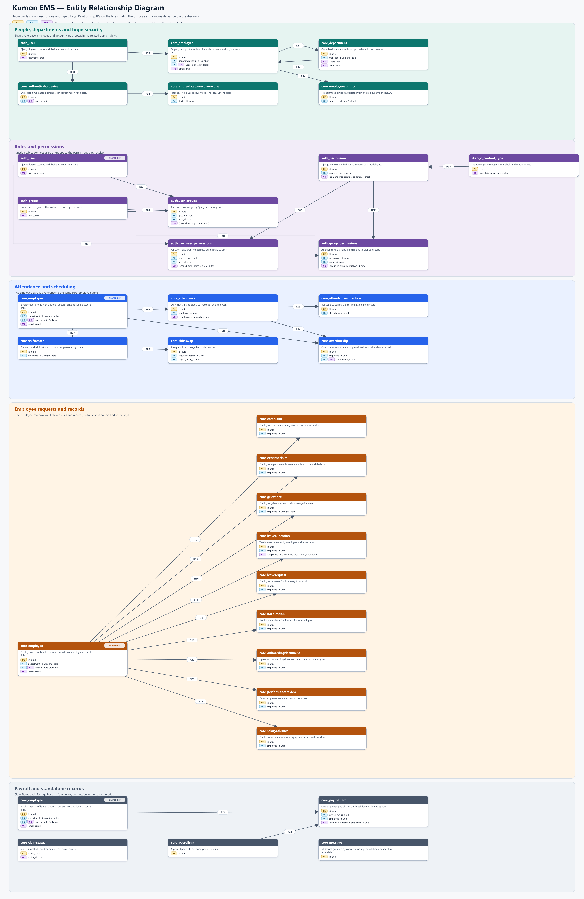

# Kumon EMS ERD

**Key colors:** PK = primary key (gold) · FK = foreign key (blue) · UQ = unique key (purple). `auto` is an integer identity, `big_auto` a bigint identity, and `uuid` a UUID. Cards show descriptions and typed keys. `SHARED REF` cards repeat the same entity to keep domain sections readable.

Connector IDs in the diagram match this relationship guide. Cardinality is written as “parent rows per child; child rows per parent.”

| ID | Connection | Cardinality | Why they are linked / what the connection supports |
|---|---|---|---|
| R01 | auth_group.id → auth.group_permissions.group_id | 1 parent per child; 0..* children per parent | stores group grants so members inherit these permissions |
| R02 | auth_permission.id → auth.group_permissions.permission_id | 1 parent per child; 0..* children per parent | records this permission in a group's shared access rules |
| R03 | auth_user.id → auth.user_groups.user_id | 1 parent per child; 0..* children per parent | records which access groups grant roles to this login |
| R04 | auth_group.id → auth.user_groups.group_id | 1 parent per child; 0..* children per parent | links users to groups whose permissions they inherit |
| R05 | auth_user.id → auth.user_user_permissions.user_id | 1 parent per child; 0..* children per parent | stores access exceptions granted directly to this account |
| R06 | auth_permission.id → auth.user_user_permissions.permission_id | 1 parent per child; 0..* children per parent | defines the action granted directly to this login account |
| R07 | django_content_type.id → auth_permission.content_type_id | 1 parent per child; 0..* children per parent | scopes permissions to an app and model for Django access checks |
| R08 | core_employee.id → core_attendance.employee_id | 1 parent per child; 0..* children per parent | ties clock records to staff for timesheets and attendance history |
| R09 | core_attendance.id → core_attendancecorrection.attendance_id | 1 parent per child; 0..* children per parent | anchors each correction request to the punch record it asks to fix |
| R10 | core_employee.id → core_complaint.employee_id | 1 parent per child; 0..* children per parent | identifies the complainant so cases can be tracked by owner |
| R11 | core_employee.id → core_department.manager_id | 0..1 parent per child; 0..* children per parent | identifies the department manager for oversight and approval routing; optional |
| R12 | core_department.id → core_employee.department_id | 0..1 parent per child; 0..* children per parent | assigns staff to an org unit for filtering and reporting; optional |
| R13 | auth_user.id → core_employee.user_id | 0..1 parent per child; 0..1 children per parent | maps login sessions to a staff profile for portal ownership and access; one to one, optional |
| R14 | core_employee.id → core_employeeauditlog.employee_id | 0..1 parent per child; 0..* children per parent | attributes actions to staff for accountability; actor link may be empty |
| R15 | core_employee.id → core_expenseclaim.employee_id | 1 parent per child; 0..* children per parent | identifies the claimant so reimbursement can be reviewed and paid |
| R16 | core_employee.id → core_grievance.employee_id | 0..1 parent per child; 0..* children per parent | links case history to staff when known; association is optional |
| R17 | core_employee.id → core_leaveallocation.employee_id | 1 parent per child; 0..* children per parent | stores annual balances for leave eligibility checks |
| R18 | core_employee.id → core_leaverequest.employee_id | 1 parent per child; 0..* children per parent | identifies requester so leave can be approved and scoped to its owner |
| R19 | core_employee.id → core_notification.employee_id | 1 parent per child; 0..* children per parent | targets in-app messages and tracks read status for each staff member |
| R20 | core_employee.id → core_onboardingdocument.employee_id | 1 parent per child; 0..* children per parent | files required paperwork under the employee onboarding record |
| R21 | core_employee.id → core_overtimeslip.employee_id | 1 parent per child; 0..* children per parent | identifies the overtime claimant for approval and compensation |
| R22 | core_attendance.id → core_overtimeslip.attendance_id | 1 parent per child; 0..1 children per parent | ties claimed extra hours to attendance evidence; at most one slip per record |
| R23 | core_payrollrun.id → core_payrollitem.payroll_run_id | 1 parent per child; 0..* children per parent | groups staff pay lines into a pay period for processing |
| R24 | core_employee.id → core_payrollitem.employee_id | 1 parent per child; 0..* children per parent | assigns each pay line to the person receiving the wages |
| R25 | core_employee.id → core_performancereview.employee_id | 1 parent per child; 0..* children per parent | keeps scores and comments in the staff review history |
| R26 | core_employee.id → core_salaryadvance.employee_id | 1 parent per child; 0..* children per parent | tracks the borrower and repayment under the staff advance record |
| R27 | core_employee.id → core_shiftroster.employee_id | 0..1 parent per child; 0..* children per parent | assigns planned shifts to staff; empty employee allows an unfilled slot |
| R28 | core_shiftroster.id → core_shiftswap.requester_roster_id | 1 parent per child; 0..* children per parent | marks the roster entry whose holder requested the exchange |
| R29 | core_shiftroster.id → core_shiftswap.target_roster_id | 1 parent per child; 0..* children per parent | marks the roster entry requested as the exchange target |
| R30 | auth_user.id → core_authenticatordevice.user_id | 1 parent per child; 0..1 children per parent | attaches MFA settings to the login account protected by TOTP; one device max |
| R31 | core_authenticatordevice.id → core_authenticatorrecoverycode.device_id | 1 parent per child; 0..* children per parent | stores backup codes with their authenticator; each code is single use |

Full column definitions and indexes are in [schema.dbml](schema.dbml).
