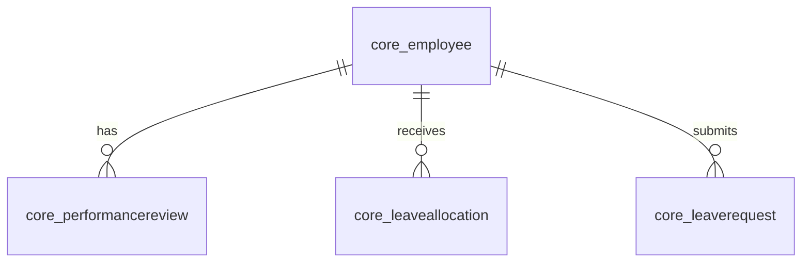
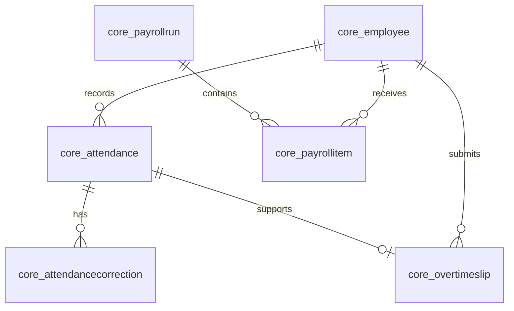
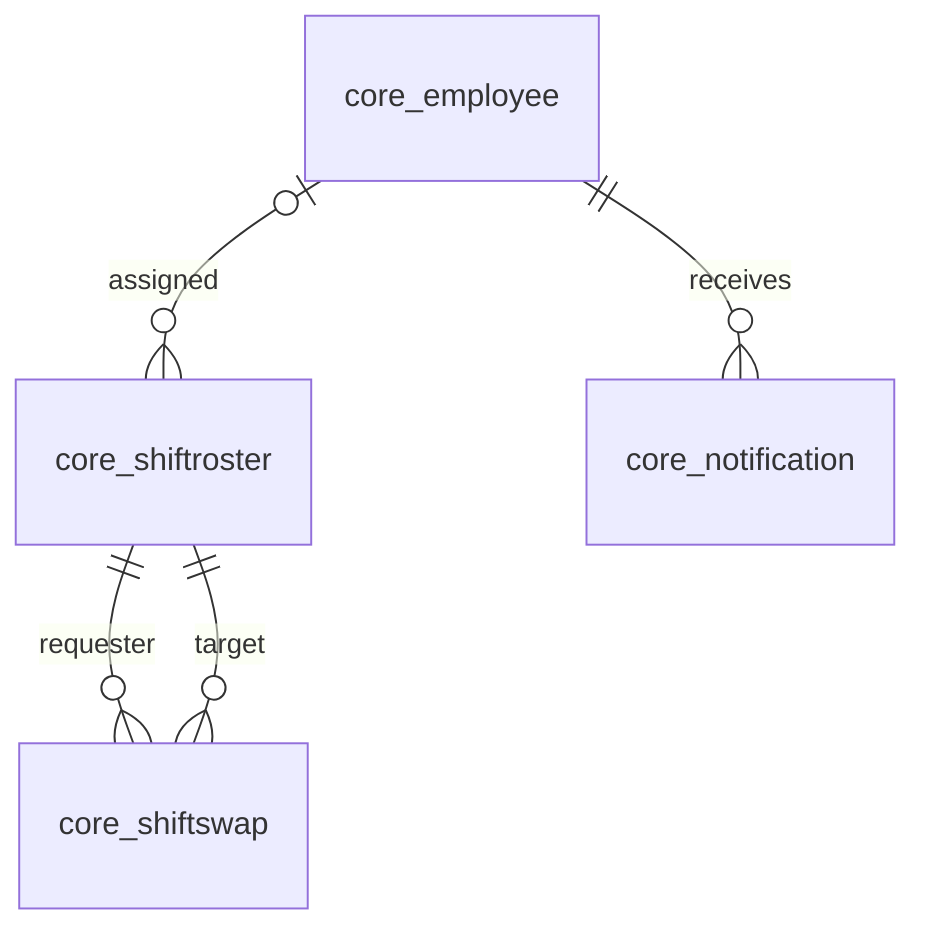
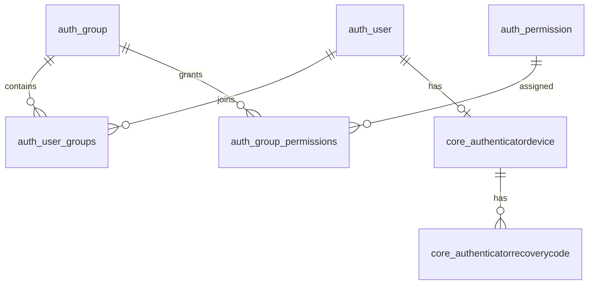
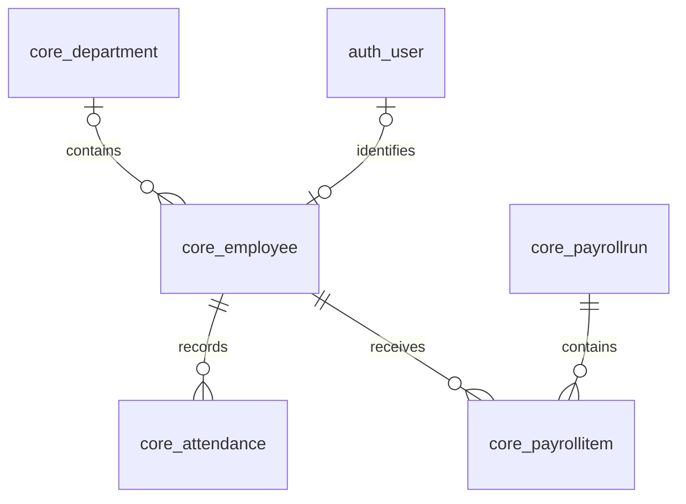

# Database normalization by objective

This analysis uses `schema.dbml` as the schema snapshot. PK means primary key; FK means foreign key. The examples show how the existing tables support normalization; they do not prove that every functional dependency satisfies 3NF.

## Objective 1: Performance and paid leave

| Normalization step | Schema example | Purpose |
|---|---|---|
| 1NF | `core_performancereview` stores one review per row; `core_leaverequest` stores one request per row. | Keeps reviews and leave requests in separate rows instead of repeating groups on an employee record. |
| 2NF | Each table has an `id` primary key. `core_leaveallocation` also has a unique `(employee_id, leave_type, year)` key for an allocation. | Each allocation's `days_total` belongs to the whole employee, leave type, and year combination. |
| 3NF design | `core_employee`, `core_performancereview`, `core_leaveallocation`, and `core_leaverequest` are separate tables linked by `employee_id`. | Employee details are stored separately from reviews, allocations, and requests. |

Leave type is stored as text in both allocation and request tables. The schema does not identify which types are paid or link a request directly to an allocation. A dashboard and paid-leave calculations require application logic.

## Objective 2: Time tracking and payroll verification

| Normalization step | Schema example | Purpose |
|---|---|---|
| 1NF | `core_attendance`, `core_attendancecorrection`, `core_overtimeslip`, `core_payrollrun`, and `core_payrollitem` use individual rows and columns. | Keeps punches, corrections, overtime, and payroll items separate. |
| 2NF | Attendance has unique `(employee_id, date)`; payroll item has unique `(payroll_run_id, employee_id)`. Both use `id` as PK. | Prevents duplicate daily attendance and duplicate employee items within one payroll run. |
| 3NF design | Payroll period details are in `core_payrollrun`; employee pay amounts are in `core_payrollitem`. Corrections reference attendance. | Avoids repeating period details for every payroll item. |

Overtime stores both `employee_id` and `attendance_id`. The model validates employee consistency, and the serializer validates employee and date against attendance, but the schema does not enforce those cross-table checks. Since `attendance_id` is unique in overtime, it is a candidate key; this repetition alone does not establish a 3NF violation. Payroll creation computes `net_pay` as `base_pay - deductions`, so these non-key amounts determine another non-key value under that rule. Treat payroll item as likely 2NF with a 3NF issue to review, including whether historical snapshots justify storing the result. Normalization and uniqueness alone do not eliminate human error or prove payroll accuracy.

## Objective 3: Shifts and notifications

| Normalization step | Schema example | Purpose |
|---|---|---|
| 1NF | `core_shiftroster` stores one shift per row; `core_shiftswap` stores one swap request per row; `core_notification` stores one notification per row. | Avoids lists of shifts, swaps, or messages in an employee row. |
| 2NF | Each table uses a single-column `id` PK. | No partial dependency on a composite primary key exists in these tables. |
| 3NF design | Swap requests reference two roster rows; notifications reference an employee. | Shift details and notification contents are kept in their own tables. |

Roster employee and work date are nullable. The schema shows no overlap constraint or direct notification-to-shift FK. Conflict detection and real-time notification delivery require application or infrastructure evidence beyond this schema.

## Objective 4: RBAC and 2FA

| Normalization step | Schema example | Purpose |
|---|---|---|
| 1NF | `auth.user_groups`, `auth.group_permissions`, and `core_authenticatorrecoverycode` store one assignment or recovery code per row. | Avoids repeating group, permission, and recovery-code lists in account rows. |
| 2NF | Junction tables use `id` PKs and unique `(user_id, group_id)` or `(group_id, permission_id)` pairs. | Prevents duplicate assignments; the pair identifies the assignment as a whole. |
| 3NF design | Accounts, groups, permissions, authenticator devices, and recovery codes are separate tables. | Separates group permissions from user membership and individual recovery credentials. |

The diagram uses Mermaid-safe names for Django's dotted junction tables. Direct user permissions also exist in `auth.user_user_permissions`. The schema records an encrypted authenticator secret and hashed recovery codes; it does not by itself prove that access checks or 2FA enforcement are active.

## Objective 5: Cloud database and integrity

| Normalization step | Schema example | Purpose |
|---|---|---|
| 1NF | Business records are organized into rows with individual fields. | Supports relational queries and updates. |
| 2NF | Tables generally use single-column PKs; selected business combinations also have unique constraints. | Identifies records and prevents specified duplicates. |
| 3NF design | Employee, department, attendance, payroll, and access records are separated and linked by FKs. | Reduces repeated entity data and supports referential integrity. |

PostgreSQL is named in the DBML. The schema alone does not establish the cloud provider, availability, encryption in transit or at rest, backups, or real-time synchronization. Those need deployment and configuration evidence.

## Scope of normalization claims

The table-card diagram labels `core_payrollitem` as conditional 2NF because the application derives net pay from non-key values. Other displayed tables are labeled conditional 3NF based on their declared keys and the dependencies evident in the models. These are provisional assessments, not proofs: unknown business rules, alternate candidate keys, or dependencies can change them. Nullable unique columns require special care when assessing candidate keys. See the [table-by-table assessment](normalization-table-assessment.md) for keys and reasoning. No claim of BCNF, 4NF, or 5NF follows from this schema snapshot alone.
